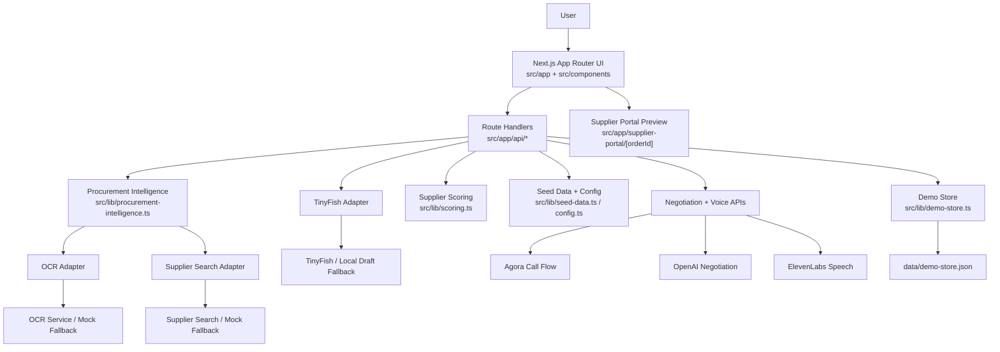
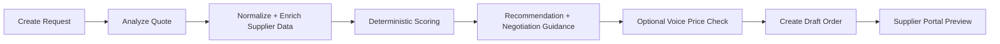

# Auto-Sourcing Pro

Auto-Sourcing Pro is a Next.js hackathon app for SME procurement teams. It turns a purchase request and a supplier quote into structured sourcing intelligence, compares two suppliers with deterministic procurement logic, recommends the best option, and creates a supplier-ready draft order through TinyFish.

The current app also includes voice-based price verification flows:

- an official Agora price-check path for live outbound test calls
- a laptop demo call that uses browser speech recognition plus the local negotiation API

## What The App Does Today

The current implementation supports these flows end to end:

1. Create a purchase request from a seeded sample or a custom form.
2. Analyze a seeded quote document or an uploaded file through the OCR adapter.
3. Build a two-supplier comparison using OCR output plus supplier-search data.
4. Score suppliers with deterministic procurement logic, not LLM-only ranking.
5. Show market benchmark, MOQ impact, stock-cover urgency, and negotiation guidance.
6. Optionally run a voice price-check flow for the benchmark supplier.
7. Create a draft order through TinyFish or the local TinyFish simulator.
8. Review the saved draft in the local supplier portal preview.

## Main Product Areas

- Dashboard with seeded demo flow and custom request creation
- Quote analysis workflow with sample document or upload path
- Procurement intelligence engine for:
  - market benchmark pricing
  - MOQ and tier economics
  - SKU and base-unit normalization
  - stock-cover and urgency logic
  - negotiation guidance
- Deterministic supplier scoring and recommendation
- Draft-order execution via TinyFish with local fallback
- Activity log and reset/replay flow
- Saved Agora system prompt settings
- OpenAI credit tracker widget with fallback mode
- Voice negotiation modes:
  - official Agora RTC call flow
  - laptop demo flow backed by `/api/agent/negotiate`

## Tech Stack

- Next.js App Router
- React 19
- TypeScript
- Tailwind CSS v4
- Local JSON persistence in [data/demo-store.json](/C:/Users/lamvu/OneDrive/Documents/Lotushacks/data/demo-store.json)

## Framework Visualization

### High-Level Architecture



### Request Flow



### Folder Map

```text
src/
|-- app/
|   |-- page.tsx
|   |-- agora-test/
|   |-- supplier-portal/[orderId]/
|   `-- api/
|       |-- requests/
|       |-- workflow/analyze/
|       |-- orders/draft/
|       |-- quotes/negotiate/
|       |-- agent/negotiate/
|       |-- agora/price-check/
|       |-- openai/credits/
|       |-- settings/agora-prompt/
|       `-- reset/
|-- components/
|   |-- dashboard-client.tsx
|   |-- agora-live-call-modal.tsx
|   |-- integrations-panel.tsx
|   `-- laptop-call-modal.tsx
`-- lib/
    |-- adapters/
    |   |-- ocr.ts
    |   |-- supplier-search.ts
    |   `-- tinyfish.ts
    |-- demo-store.ts
    |-- procurement-intelligence.ts
    |-- scoring.ts
    |-- seed-data.ts
    |-- config.ts
    `-- types.ts
```

## Repository Structure

### Main UI

- Home page: [src/app/page.tsx](/C:/Users/lamvu/OneDrive/Documents/Lotushacks/src/app/page.tsx)
- Main dashboard: [src/components/dashboard-client.tsx](/C:/Users/lamvu/OneDrive/Documents/Lotushacks/src/components/dashboard-client.tsx)
- Live call modal: [src/components/agora-live-call-modal.tsx](/C:/Users/lamvu/OneDrive/Documents/Lotushacks/src/components/agora-live-call-modal.tsx)
- Integrations panel: [src/components/integrations-panel.tsx](/C:/Users/lamvu/OneDrive/Documents/Lotushacks/src/components/integrations-panel.tsx)
- Supplier portal preview: [src/app/supplier-portal/[orderId]/page.tsx](/C:/Users/lamvu/OneDrive/Documents/Lotushacks/src/app/supplier-portal/%5BorderId%5D/page.tsx)
- Agora test page: [src/app/agora-test/page.tsx](/C:/Users/lamvu/OneDrive/Documents/Lotushacks/src/app/agora-test/page.tsx)

### Core Logic

- Store and snapshot builder: [src/lib/demo-store.ts](/C:/Users/lamvu/OneDrive/Documents/Lotushacks/src/lib/demo-store.ts)
- Seed data and default prompt: [src/lib/seed-data.ts](/C:/Users/lamvu/OneDrive/Documents/Lotushacks/src/lib/seed-data.ts)
- Procurement intelligence engine: [src/lib/procurement-intelligence.ts](/C:/Users/lamvu/OneDrive/Documents/Lotushacks/src/lib/procurement-intelligence.ts)
- Supplier scoring: [src/lib/scoring.ts](/C:/Users/lamvu/OneDrive/Documents/Lotushacks/src/lib/scoring.ts)
- Shared config: [src/lib/config.ts](/C:/Users/lamvu/OneDrive/Documents/Lotushacks/src/lib/config.ts)
- Shared types: [src/lib/types.ts](/C:/Users/lamvu/OneDrive/Documents/Lotushacks/src/lib/types.ts)

### Adapters

- OCR adapter: [src/lib/adapters/ocr.ts](/C:/Users/lamvu/OneDrive/Documents/Lotushacks/src/lib/adapters/ocr.ts)
- Supplier search adapter: [src/lib/adapters/supplier-search.ts](/C:/Users/lamvu/OneDrive/Documents/Lotushacks/src/lib/adapters/supplier-search.ts)
- TinyFish adapter: [src/lib/adapters/tinyfish.ts](/C:/Users/lamvu/OneDrive/Documents/Lotushacks/src/lib/adapters/tinyfish.ts)

### API Routes

- Create request: [src/app/api/requests/route.ts](/C:/Users/lamvu/OneDrive/Documents/Lotushacks/src/app/api/requests/route.ts)
- Analyze quote workflow: [src/app/api/workflow/analyze/route.ts](/C:/Users/lamvu/OneDrive/Documents/Lotushacks/src/app/api/workflow/analyze/route.ts)
- Draft order: [src/app/api/orders/draft/route.ts](/C:/Users/lamvu/OneDrive/Documents/Lotushacks/src/app/api/orders/draft/route.ts)
- Reset demo store: [src/app/api/reset/route.ts](/C:/Users/lamvu/OneDrive/Documents/Lotushacks/src/app/api/reset/route.ts)
- Save Agora prompt: [src/app/api/settings/agora-prompt/route.ts](/C:/Users/lamvu/OneDrive/Documents/Lotushacks/src/app/api/settings/agora-prompt/route.ts)
- Start Agora price check: [src/app/api/agora/price-check/route.ts](/C:/Users/lamvu/OneDrive/Documents/Lotushacks/src/app/api/agora/price-check/route.ts)
- Stop Agora price check: [src/app/api/agora/price-check/stop/route.ts](/C:/Users/lamvu/OneDrive/Documents/Lotushacks/src/app/api/agora/price-check/stop/route.ts)
- Browser negotiation agent: [src/app/api/agent/negotiate/route.ts](/C:/Users/lamvu/OneDrive/Documents/Lotushacks/src/app/api/agent/negotiate/route.ts)
- Persist negotiated quote: [src/app/api/quotes/negotiate/route.ts](/C:/Users/lamvu/OneDrive/Documents/Lotushacks/src/app/api/quotes/negotiate/route.ts)
- OpenAI credits endpoint: [src/app/api/openai/credits/route.ts](/C:/Users/lamvu/OneDrive/Documents/Lotushacks/src/app/api/openai/credits/route.ts)

## Current Behavior And Logic

### Procurement recommendation

Supplier ranking is deterministic. The app rescoring logic combines:

- quote price versus benchmark median
- MOQ fit and effective unit price
- recommended buy quantity
- stock sufficiency and safety buffer
- stock-cover urgency versus lead time
- supplier rating
- delivery speed

This is why the recommendation remains stable in mock mode and explainable during demos.

### Voice price-check modes

There are two different voice paths in the current codebase:

- `official`: starts an Agora Conversational AI Agent session, generates browser RTC join data, and is restricted to `AGORA_ALLOWED_TEST_PHONE`
- `laptop-demo`: skips Agora RTC setup and opens the live call modal in browser-only mode, using `/api/agent/negotiate` for text generation and ElevenLabs for speech synthesis when available

Important: the laptop demo path is not the same as the legacy local-only mock call component. The active dashboard flow uses [src/components/agora-live-call-modal.tsx](/C:/Users/lamvu/OneDrive/Documents/Lotushacks/src/components/agora-live-call-modal.tsx) for both modes.

### Persistence

App state is stored in [data/demo-store.json](/C:/Users/lamvu/OneDrive/Documents/Lotushacks/data/demo-store.json). The store currently keeps:

- requests
- active request id
- saved Agora system prompt
- extracted quote
- supplier quotes
- recommendation
- draft order
- recent activity events

Resetting the demo clears workflow state but preserves the saved Agora prompt.

## Mock Mode And Fallbacks

The app is intentionally demo-safe. If live services are missing or fail at runtime:

- OCR falls back to deterministic extracted quote data
- supplier search falls back to deterministic benchmark suppliers
- TinyFish falls back to a local supplier portal draft flow
- browser negotiation falls back to deterministic text replies if OpenAI is unavailable
- browser negotiation returns text-only replies if ElevenLabs is unavailable

The dashboard surfaces mock/live status for OCR, supplier search, and TinyFish.

## Environment Variables

Copy [.env.example](/C:/Users/lamvu/OneDrive/Documents/Lotushacks/.env.example) to `.env.local` and fill only the integrations you want to enable.

### Core demo behavior

- `FORCE_MOCK_MODE`

### OCR adapter

- `INTERFAZE_API_URL`
- `INTERFAZE_API_KEY`

### Supplier search adapter

- `EXA_API_URL`
- `EXA_API_KEY`

### TinyFish draft execution

- `TINYFISH_API_URL`
- `TINYFISH_API_KEY`

### OpenAI and browser negotiation

- `OPENAI_API_KEY`
- `OPENAI_MODEL`
- `OPENAI_ORGANIZATION_ID`
- `OPENAI_PROJECT_ID`
- `OPENAI_CREDIT_API_URL`

### ElevenLabs speech synthesis for the laptop demo flow

- `ELEVENLABS_API_KEY`
- `ELEVENLABS_VOICE_ID`

### Official Agora call flow

- `AGORA_ALLOWED_TEST_PHONE`
- `AGORA_APP_ID`
- `AGORA_APP_CERTIFICATE`
- `AGORA_RTC_TOKEN`
- `AGORA_CLIENT_RTC_TOKEN`
- `AGORA_AUTH_TOKEN`
- `AGORA_CUSTOMER_ID`
- `AGORA_CUSTOMER_SECRET`
- `AGORA_TTS_KEY`
- `AGORA_TTS_REGION`
- `AGORA_TTS_VOICE`
- `AGORA_ASR_LANGUAGE`
- `AGORA_LLM_URL`
- `AGORA_LLM_SYSTEM_PROMPT`

Notes:

- If `AGORA_APP_CERTIFICATE` is set, the app can generate fresh RTC tokens for the browser join path.
- If `AGORA_APP_CERTIFICATE` is not set, you must provide both `AGORA_RTC_TOKEN` and `AGORA_CLIENT_RTC_TOKEN`.
- The official Agora route allows calls only to the configured `AGORA_ALLOWED_TEST_PHONE`.
- The saved prompt in the dashboard can override the environment prompt for new official calls.

## Local Development

Requirements:

- Node.js 20+
- npm 10+

Install and run:

```bash
npm install
npm run dev
```

Open [http://localhost:3000](http://localhost:3000).

Other scripts:

```bash
npm run lint
npm run build
npm run start
npm run test:agora:voice
```

## Recommended Demo Walkthrough

1. Open the dashboard.
2. Click `Load Sample Request`.
3. Click `Use Sample Document`.
4. Explain the market benchmark, MOQ, stock-cover, and negotiation guidance sections.
5. Show why the recommended supplier ranks highest.
6. If the benchmark supplier has no observed live price, run a price-check flow.
7. Click `Create Draft Order via TinyFish`.
8. Open the supplier portal preview.
9. Use `Start New Demo Run` to replay the scenario quickly.

## Known Scope Boundaries

This project currently does not implement:

- authentication
- tenant separation
- real ERP integration
- approval workflows
- multi-supplier auctions beyond the two-quote comparison pattern
- formal automated tests wired into the npm script set beyond the Agora helper script

## Extra Project Notes

This repo also contains several ad hoc investigation notes and helper scripts such as:

- `AGORA_DEBUG_GUIDE.md`
- `AUDIO_DEBUG_GUIDE.md`
- `AGORA_FIX_ANALYSIS.md`
- `test-api.mjs`
- `test-ocr.mjs`

Those files are useful for troubleshooting, but they are not part of the primary runtime flow.
